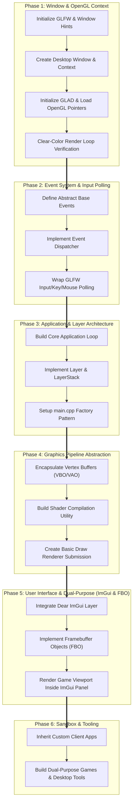

MyEngine/
├── include/
│   ├── core/         # Window, Input, Time, Camera
│   ├── graphics/     # Shader, Texture, Mesh, Model, Renderer
│   ├── scene/        # GameObject, Transform, Scene
│   └── utils/        # Logger, File loader, Constants
├── src/
│   ├── core/
│   ├── graphics/
│   ├── scene/
│   └── main.cpp      # Only initializes the Engine and starts it!
├── resources/
│   ├── shaders/      # .vs and .fs files
│   └── textures/     # .jpg, .png files
└── CMakeLists.txt    # Modern build configuration

MyEngine/
├── include/                  <-- Header files (.hpp / .h) - declarations only (classes, structs)
│   ├── core/                 <-- Engine infrastructure headers
│   │   ├── Engine.hpp        <-- Manages window lifecycle, game loop, and delta time
│   │   └── Input.hpp         <-- Handles keyboard and mouse states
│   └── graphics/             <-- Rendering system headers
│       ├── Shader.hpp        <-- Declares the Shader class (loading & setting uniforms)
│       ├── Texture.hpp       <-- Declares the Texture loader
│       └── Mesh.hpp          <-- Declares VAO/VBO vertex data structures
├── src/                      <-- Source files (.cpp) - actual implementation code
│   ├── core/
│   │   ├── Engine.cpp        <-- Implements window creation, glfw polling, and update loops
│   │   └── Input.cpp         <-- Implements key/mouse callbacks
│   ├── graphics/
│   │   ├── Shader.cpp        <-- Implements GLSL shader compilation and uniform setters
│   │   ├── Texture.cpp       <-- Implements stb_image loading into OpenGL texture buffers
│   │   └── Mesh.cpp          <-- Implements vertex buffer data uploads
│   └── main.cpp              <-- Entry point: creates the Engine instance and starts it
├── resources/                <-- Asset files (never hardcoded into source code)
│   ├── shaders/              <-- Raw GLSL files (.vs and .fs)
│   └── textures/             <-- Image files (.jpg, .png like container.jpg)
└── CMakeLists.txt            <-- Build automation configuration (or your g++ build command)

MyEngine/
├── glad/                     <-- Glad loader files (include/ and src/glad.c)
├── imgui/                    <-- Dear ImGui source files (*.cpp, *.h, and backends/)
├── include/                  <-- Your own engine headers
├── src/                      <-- Your own engine source files
└── main.cpp

